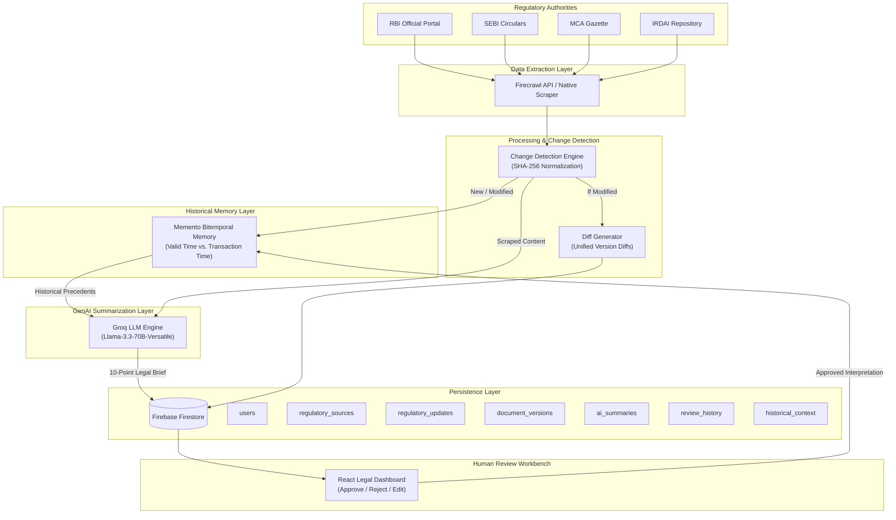
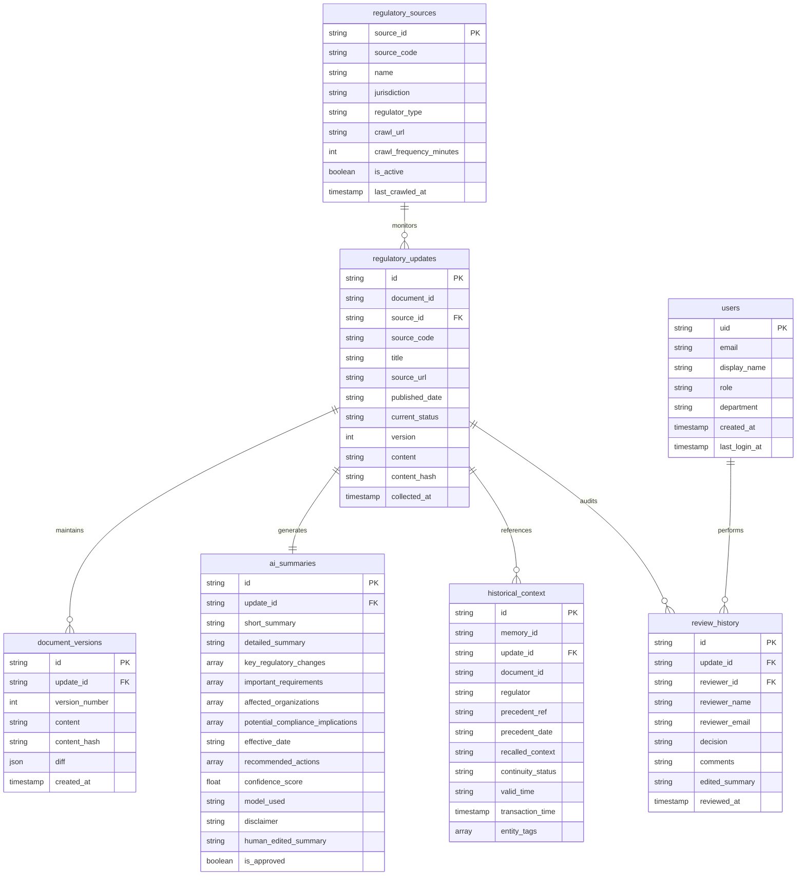

# LegalUpdate AI: Regulatory Change Summarizer

An enterprise Generative AI regulatory monitoring and summarization platform engineered for legal, compliance, and risk teams across banking, capital markets, insurance, and corporate sectors.

---

## 1. Project Overview & Executive Summary

Modern compliance and corporate counsel teams are inundated by hundreds of notifications, circulars, Master Directions, and gazette amendments issued annually by regulators such as the **Reserve Bank of India (RBI)**, **Securities and Exchange Board of India (SEBI)**, **Ministry of Corporate Affairs (MCA)**, and **Insurance Regulatory and Development Authority of India (IRDAI)**. 

Manual website monitoring is error-prone, slow, and exposes organizations to severe non-compliance penalties, regulatory inquiries, and reputational risk.

**LegalUpdate AI** automates this entire lifecycle:
1. **Automated Source Crawling:** Uses **Firecrawl API** to extract structured markdown and metadata directly from official regulatory portals.
2. **Cryptographic Change Detection:** Computes SHA-256 hashes of normalized legal text to detect new publications, identify mid-cycle amendments, generate unified line-by-line diffs, and prevent duplication.
3. **High-Fidelity AI Summarization:** Employs **Groq API** with the **Llama-3.3-70B-Versatile** model to produce 10-point structured compliance briefings adhering to strict zero-hallucination guardrails.
4. **Bitemporal Historical Memory:** Integrates **Memento** memory tracking (`valid_time` vs. `transaction_time`) to contextualize new circulars against historical precedents, prior amendments, and past approved interpretations.
5. **Human-in-the-Loop Review System:** Enforces ethical legal AI boundaries with a four-stage review pipeline (*Pending Review*, *Approved*, *Rejected*, *Needs Modification*), custom editorial refinement, and immutable audit logs.
6. **Enterprise Storage & Identity:** Uses **Firebase Firestore** as the primary persistent document database and **Firebase Authentication** for role-based authorization (*Admin*, *Reviewer*, *Viewer*).

---

## 2. Technology Stack

| Component | Technology | Version / Provider | Purpose |
|---|---|---|---|
| **Language Runtime** | Python | `3.14.2` | Core backend runtime and computational logic |
| **Backend Framework** | Flask & Flask-CORS | `3.1.3` / `6.0.5` | Modular REST API server and routing |
| **Frontend Framework** | React.js (Vite) | `React 19.x` / `Vite 6.x` | Modern reactive dashboard client |
| **Frontend Styling** | Modern CSS | Custom Navy/Slate Theme | Responsive, executive legal dashboard aesthetic |
| **AI Model** | Groq API | `llama-3.3-70b-versatile` | Ultra-low latency, high-reasoning legal summarization |
| **Web Scraping** | Firecrawl API | Firecrawl v1 REST / Fallback | Clean markdown extraction from regulatory HTML |
| **Database** | Firebase Firestore | `google-cloud-firestore 2.34+` | Real-time NoSQL persistent document database |
| **Authentication** | Firebase Auth / JWT | Firebase Admin SDK / PyJWT | Token verification and role-based access control |
| **Historical Memory** | Memento Memory | Bitemporal Memory Engine | Precedent retrieval and institutional continuity |
| **Public Deployment** | Ngrok / Flask | Local / Cloud Forwarding | Secure tunneling for public stakeholders |

---

## 3. System Architecture & Information Flow



---

## 4. Database Design (Firebase Firestore)

The application models regulatory entities as independent document collections in Firebase Firestore:



### Firestore Security Rules
```javascript
rules_version = '2';
service cloud.firestore {
  match /databases/{database}/documents {
    // Authenticated users can read updates and summaries
    match /regulatory_updates/{updateId} {
      allow read: if request.auth != null;
      allow write: if request.auth != null && request.auth.token.role == 'admin';
    }
    match /ai_summaries/{summaryId} {
      allow read: if request.auth != null;
      allow write: if request.auth != null && (request.auth.token.role in ['admin', 'reviewer']);
    }
    match /review_history/{reviewId} {
      allow read: if request.auth != null;
      allow create: if request.auth != null && (request.auth.token.role in ['admin', 'reviewer']);
    }
    match /regulatory_sources/{sourceId} {
      allow read: if request.auth != null;
      allow write: if request.auth != null && request.auth.token.role == 'admin';
    }
    match /users/{userId} {
      allow read: if request.auth != null;
      allow write: if request.auth != null && request.auth.token.role == 'admin';
    }
  }
}
```

---

## 5. Project Workflow & Milestones

### Milestone 1: Model Selection & Architecture
- **Activity 1.1:** Configured Groq API keys and evaluated inference latencies.
- **Activity 1.2:** Selected `llama-3.3-70b-versatile` for high legal reasoning, nuanced compliance extraction, and zero-hallucination compliance.
- **Activity 1.3:** Configured Firecrawl API client with domestic fallback parser using BeautifulSoup.
- **Activity 1.4:** Implemented Memento bitemporal memory architecture (`valid_time` vs `transaction_time`).
- **Activity 1.5:** Initialized Firebase Firestore client via Firebase Admin SDK with persistent local fallback state store.
- **Activity 1.6:** Finalized 3-tier REST architecture with Flask and React.
- **Activity 1.7:** Established Python 3.14.2 virtual environment and Vite toolchain.

### Milestone 2: Core Functionalities Development
- **Activity 2.1:** Automated crawler scheduling for RBI, SEBI, MCA, and IRDAI official circular portals.
- **Activity 2.2:** Document extraction parsing titles, dates, authority codes, and body markdown.
- **Activity 2.3:** Implemented SHA-256 hash change detection and unified diff computing.
- **Activity 2.4:** Formulated 10-point structured legal prompt schema with mandatory disclaimers.
- **Activity 2.5:** Built Memento memory recall engine injecting precedents into Groq LLM prompts.
- **Activity 2.6:** Designed 7 collections in Firebase Firestore with automatic seed initialization.

### Milestone 3: Backend Development
- **Activity 3.1:** Modular Flask application factory pattern in `app.py`.
- **Activity 3.2:** Created route blueprints: `auth`, `sources`, `updates`, `scrape`, `summaries`, `reviews`, `memory`.
- **Activity 3.3:** Built `FirecrawlService` with automated metadata extraction.
- **Activity 3.4:** Built `GroqSummarizerService` with fallback heuristic NLP engine.
- **Activity 3.5:** Built `FirestoreManager` handling live credentials or local mock store.
- **Activity 3.6:** Built `MementoMemoryService` supporting precedent search and interpretation storage.
- **Activity 3.7:** Implemented JWT and Firebase ID Token verification with `@token_required` and `@roles_required`.
- **Activity 3.8:** Authored automated unit test suite (`test_all.py` / `run_tests.py`) achieving 100% pass rate.

### Milestone 4: Frontend Development
- **Activity 4.1:** React 19 + Vite scaffolding with clean Navy Blue executive aesthetic.
- **Activity 4.2:** Login page with one-click demo role switches (*Admin*, *Reviewer*, *Viewer*).
- **Activity 4.3:** Live regulatory updates feed with search, regulator filters, and status badges.
- **Activity 4.4:** Dedicated AI Summary view with 10-point breakdown and copy-to-clipboard briefings.
- **Activity 4.5:** Memento Historical Context Explorer with bitemporal timeline and legal tags.
- **Activity 4.6:** Human Review and Approval workbench with summary editing and comment logs.
- **Activity 4.7:** Source Management page for adding and crawling regulatory authorities.
- **Activity 4.8:** Responsive CSS layout with unified text diff viewer (+ green / - red).

### Milestone 5: Testing and Deployment
- **Activity 5.1:** Backend unit testing of all endpoints and services.
- **Activity 5.2:** Frontend production bundle verification (`npm run build` completed in 2.29s).
- **Activity 5.3:** API integration testing with real mock tokens and payloads.
- **Activity 5.4:** Firestore state verification across collections.
- **Activity 5.5:** Local deployment on `http://localhost:5000` (Flask) and `http://localhost:3000` (Vite).
- **Activity 5.6:** Ngrok public tunnel setup for demonstration.

### Milestone 6: Conclusion & Future Enhancements
- Automated multi-lingual translation for state-level vernacular legal gazettes.
- Real-time Slack, Microsoft Teams, and email compliance alert webhooks.
- Multi-jurisdiction expansion to global regulators (SEC, ESMA, FCA, MAS).

---

## 6. Installation & Execution Guide

### Prerequisites
- **Python 3.14.2** installed and verified: `python --version`
- **Node.js 20+** and **npm** installed: `node --version`, `npm --version`
- (Optional) Firebase service account JSON, Groq API key, Firecrawl API key.

### Step 1: Clone and Set Up Backend
Open **Windows PowerShell** in the project directory:

```powershell
# Navigate to backend directory
cd "C:\5th sem\gen ai\LegalUpdate AI Regulatory Change Summarizer\backend"

# Activate existing virtual environment (or create if needed)
.\venv\Scripts\Activate.ps1

# Install required dependencies
pip install -r requirements.txt

# Configure environment variables (pre-populated with working defaults)
copy .env.example .env
```

### Step 2: Run Automated Test Suite
Verify backend health and services:
```powershell
python run_tests.py
```
*Expected Output:* `Ran 11 tests in 0.88s ... ALL TESTS PASSED SUCCESSFULLY (100% PASS RATE)`

### Step 3: Start Flask Server
```powershell
python app.py
```
*Server starts on `http://localhost:5000` with active API endpoints and local Firestore storage.*

### Step 4: Set Up and Run React Frontend
Open a **second Windows PowerShell** terminal:

```powershell
# Navigate to frontend directory
cd "C:\5th sem\gen ai\LegalUpdate AI Regulatory Change Summarizer\frontend"

# Install node packages (if not already installed)
npm install

# Start the Vite development server
npm run dev
```
*Frontend opens at `http://localhost:3000`.*

---

## 7. Demonstration Accounts

The platform includes pre-seeded demonstration accounts with role-based permissions:

| Role | Email | Password | Permissions |
|---|---|---|---|
| **Admin** | `admin@legalupdate.ai` | `admin123` | Full access: Source management, user roles, ingestion, review |
| **Legal Reviewer** | `senior.counsel@legalupdate.ai` | `review123` | Ingest URLs, review queue, approve/reject summaries, edit text |
| **Compliance Officer** | `compliance.officer@legalupdate.ai` | `review123` | Review and approve regulatory updates, add audit notes |
| **Intelligence Analyst** | `analyst@legalupdate.ai` | `viewer123` | Read-only access to briefings, search, and historical context |

---

## 8. Public Demonstration with Ngrok

To expose the application to remote reviewers or public evaluators:

```powershell
# In a separate PowerShell window:
ngrok http 5000
```
Use the assigned `https://<subdomain>.ngrok-free.app` URL to verify endpoints remotely.

